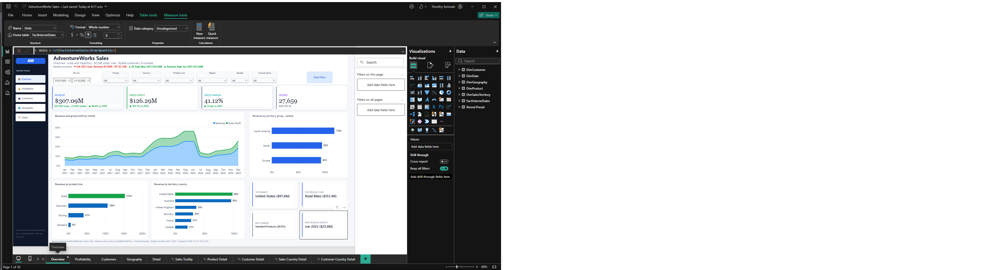
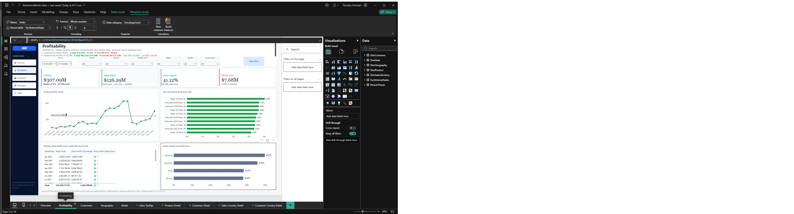
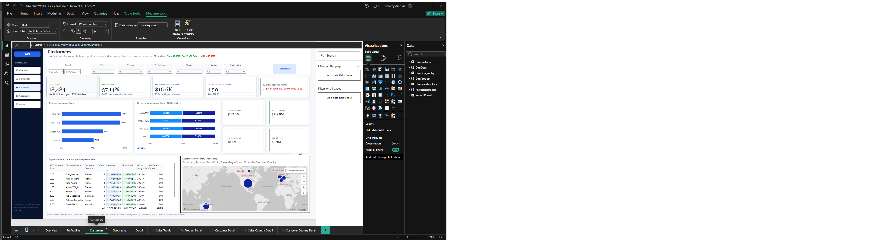
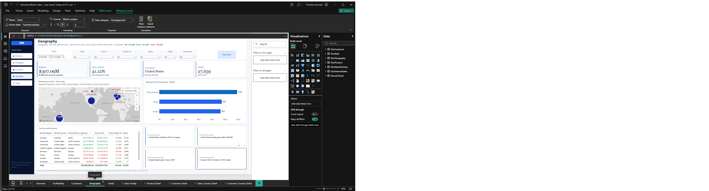
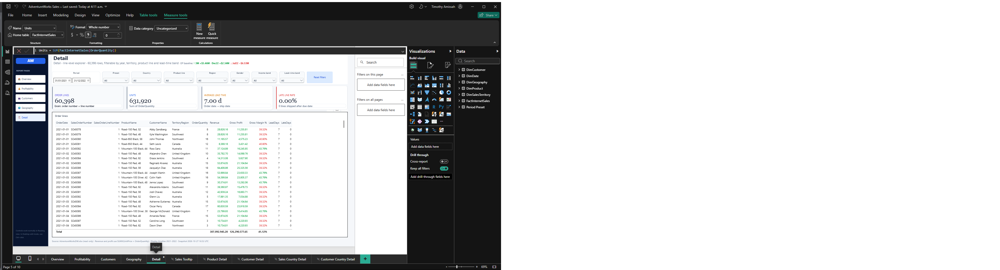

# AdventureWorks Internet Sales Report

## 1. Document Purpose

This document describes the AdventureWorks Internet Sales Power BI report from business use through data model, report design, refresh, publishing, maintenance, and troubleshooting.

The primary deliverable is [AdventureWorks Sales.pbix](./AdventureWorks%20Sales.pbix). The editable Power BI project source is [pbi/AdventureWorks Internet Sales.pbip](./pbi/AdventureWorks%20Internet%20Sales.pbip), with its report definition under [pbi/AdventureWorks Internet Sales.Report/](./pbi/AdventureWorks%20Internet%20Sales.Report/) and semantic model under [pbi/AdventureWorks Internet Sales.SemanticModel/](./pbi/AdventureWorks%20Internet%20Sales.SemanticModel/). The read-only source workbook is [AdventureWorksDW.xlsx](./AdventureWorksDW.xlsx).

## 2. Business Objective

The report provides an interactive view of AdventureWorks Internet Sales performance. It supports analysis of:

- Revenue, gross profit, gross margin, orders, units, and average order value
- Revenue and margin trends over time
- Product-line and product-level profitability
- Customer value, repeat purchasing, income, gender, and location
- Territory, region, and country performance
- Order-line fulfillment, shipping lead time, and late shipments

## 3. Expected Audience

- Sales leadership monitoring revenue and profitability
- Product management comparing product performance
- Customer analytics teams reviewing customer behavior
- Territory and regional managers
- Finance and operations teams validating financial and fulfillment metrics

## 4. Report Summary

| Item | Current value |
|---|---:|
| Report format | PBIP/PBIR and PBIX |
| Report pages | 5 |
| Page size | 1920 × 1080 |
| Model tables | 7 |
| Model measures | 65 |
| Relationships | 6 |
| Fact grain | Sales order number + sales order line number |

The report currently delivers the following verified business snapshot:

| Metric | Snapshot |
|---|---:|
| Revenue | $307,092,945.20 |
| Gross profit | $126,290,577.65 |
| Gross margin | 41.12% |
| Units | 631,920 |
| Orders | 27,659 |
| Customers | 18,484 |
| Reporting period | January 2021–December 2022 |

## 5. Report Pages

### 5.1 Overview

Purpose: executive summary of sales and profitability.

Main content:

- Revenue card
- Gross profit card
- Gross margin card
- Orders card
- Revenue and gross profit by month
- Revenue by territory group
- Revenue by product line
- Revenue by territory country
- Period, preset, country, product-line, region, gender, and income-band filters

Recommended analysis:

1. Start with the reporting period.
2. Compare monthly revenue with gross profit.
3. Identify the strongest territory group and product line.
4. Add country, region, customer, and product filters to isolate a segment.

### 5.2 Profitability

Purpose: analyze margin, cost, product contribution, freight, and unit economics.

Main content:

- Gross profit card
- Gross margin card
- Revenue card
- Freight cost card
- Gross margin by month
- Top 10 products by gross profit
- Gross margin by product line
- Top 10 product detail table
- Period and business-segment filters

Recommended analysis:

1. Check gross margin over time.
2. Compare product lines by margin.
3. Use the top-product chart to identify gross-profit drivers.
4. Use the detail table to inspect revenue, profit, margin, and units together.

### 5.3 Customers

Purpose: understand customer value and purchasing behavior.

Main content:

- Customers card
- Repeat rate card
- Revenue per customer card
- Orders per customer card
- Revenue by income band
- Customers by gender
- Revenue by customer value band
- Top 10 customers by revenue
- A customer-comment or narrative area
- Period and business-segment filters

Recommended analysis:

1. Review customer count and repeat-rate KPIs.
2. Compare revenue by income band and value band.
3. Identify repeat behavior by segment.
4. Inspect the top customer table for order, revenue, and profit concentration.

### 5.4 Geography

Purpose: compare territories, regions, and countries.

Main content:

- Revenue card
- Gross margin card
- Territories card
- Orders card
- Revenue by territory country
- Revenue by territory group
- Territory performance detail table
- Period and business-segment filters

Recommended analysis:

1. Compare territory groups.
2. Identify countries generating the highest revenue.
3. Review territory gross margin and order counts.
4. Filter by product line, country, customer segment, or date to isolate opportunities.

### 5.5 Detail

Purpose: inspect individual order lines and fulfillment performance.

Main content:

- Order-line count card
- Units card
- Average lead-time card
- Late-line rate card
- Order-line table
- Period and business-segment filters
- Lead-time-band filter

The detail table includes:

- Order date
- Sales order number
- Sales order line number
- Product name
- Customer name
- Territory region
- Order quantity
- Revenue
- Gross profit
- Lead days
- Late days

Use this page for drill-through-style inspection, data validation, and exception analysis.

## 5.6 Report Screenshots, Findings, and Trends

The screenshots below are live captures from the `AdventureWorks Sales.pbix` report opened in Power BI Desktop. They are page-specific Desktop captures and show the values in the PBIX at capture time. Power BI Desktop remains the source of truth for the values displayed below.

### Overview



**Key findings**

- Total revenue is $307.09 million across 631,920 units and 27,659 orders.
- Gross profit is $126.29 million, producing a 41.12% gross margin.
- 2022 produced $204.24 million, or 66.51% of total revenue, compared with $102.85 million in 2021.
- Revenue increased from approximately $40 million per month near early 2022 to approximately $50 million by December 2022.
- Revenue and gross profit follow a similar monthly pattern, indicating that profit generally expands when sales expand.
- Revenue share is strongest in North America at $118.33 million, followed by Europe at $95.22 million and the Pacific at $93.34 million.
- The United States is the largest country-level revenue market at approximately $98 million.
- The Mountain product line generates approximately $153 million, making it the strongest product-line performer.

**Insight**

The strongest opportunity is to protect North American volume while investigating the sustained growth in 2022. The similar trend in revenue and gross profit suggests that overall profitability improved with scale rather than through a sharply different sales mix.

### Profitability



**Key findings**

- Gross profit is $126.29 million and gross margin is 41.12%.
- Freight cost is $7.68 million, representing approximately 2.50% of revenue.
- The monthly gross-profit trend shows a sharp 2022 increase, a late-period dip, and a rebound.
- The displayed monthly table alternates between revenue, gross profit, and gross margin for each month.
- The territory distribution of the gross-margin view shows North America at 49%, Pacific at 30%, and Europe at 21%.
- The monthly margin chart shows short-term volatility but no sustained late-period decline.
- The gross-margin-by-product visual ranks the displayed Mountain, Road, Touring, and Standard groups in ascending order of margin.
- The gross-profit-by-product visual highlights Mountain-200 Black-38 as the largest displayed product contributor, with Mountain-200 Black-46 also near the top.

**Insight**

Standard and Mountain products deserve further margin-focused analysis. Revenue growth and a stable or improving gross margin create a favorable profit-quality trend, but the monthly margin fluctuations indicate that mix, pricing, or product availability may change profitability between periods.

### Customers



**Key findings**

- The report identifies 18,484 customers and 27,659 orders.
- Repeat rate is 37.14%, with 6,865 repeat customers.
- Average revenue per customer is approximately $16.6 thousand, while average orders per customer is 1.50.
- Revenue by income band shows the highest displayed band at $152.2 million for $70K–$100K.
- The gender split shown is approximately 50.12% male and 49.88% female in the selected view.
- The Customers page displays $152.2 million for the $70K–$100K revenue band and $137.0 million for the $50K–$70K band.
- Customer concentration is meaningful: the top 10 customers contribute approximately 0.50% of revenue, while the remaining 18,474 customers account for 99.5%.
- The top-customer table highlights purchases concentrated in France, Germany, the United States, and Australia.
- The $50K–$100K customer value bands are the largest revenue contributors in the customer-value view.

**Insight**

Customer buying is relatively diversified: the highest-value group does not dominate total revenue, even though repeat purchasers are significant. Growth activities can focus on repeat-rate improvement, cross-selling to the highest-income segment, and targeted retention for the 6,865 repeat customers.

### Geography



**Key findings**

- The report covers 10 territories, 3 territory groups, and 60,398 order lines.
- Revenue is $307.09 million with a 41.12% gross margin.
- North America contributes approximately $119 million in the territory bar, while Pacific and Europe are approximately $90 million each.
- The displayed territory table includes North America at $119.7 million, Pacific at $91.16 million, and Europe at $96.21 million.
- Australia generates approximately $95 million and is the largest territory country visible in the chart.
- The United States is approximately $98 million and the United Kingdom approximately $36 million.
- Australia, Southwest, and Northwest are leading territory rows in the displayed performance table.
- Territory-level gross margins are generally around 40%–42%, with the displayed table showing roughly 40%–46% by territory/country combination.
- Only one territory/filter path should be used in a visual to avoid ambiguous customer and geography filtering.

**Insight**

Geographic revenue is balanced across the North America, Europe, and Pacific groups, reducing dependence on any one region. Australia and the United States offer the largest revenue concentration, while the consistent territory margins indicate that growth investment should consider market share rather than relying only on margin differences.

### Detail



**Key findings**

- The Detail page contains 60,398 order lines and 631,920 units.
- Average lead time is 7.00 days, and the displayed sample shows zero late lines.
- The sample table lists individual customers and products associated with each sales order and line.
- Lead days are consistently seven days in the displayed rows, with zero late days.
- Revenue and gross profit can be audited at order-line level by combining order quantity, unit price, unit cost, and computed measures.
- The page supports slicing by period, country, product line, territory region, gender, income band, and lead-time band.

**Insight**

The report's line-level design supports operational and data-quality checks. Current detail results indicate a consistently short seven-day lead-time pattern with no visible late shipments, but users should validate this against refreshed source data because the displayed screenshot may be based on a sample or exported snapshot.

## 6. Common Filters

Most pages contain the following filters:

| Filter | Source field |
|---|---|
| Period | `DimDate[Date]` |
| Preset | `Period Preset[Preset]` |
| Country | `DimCustomer[Customer Country]` |
| Product line | `DimProduct[ProductLine]` |
| Region | `DimSalesTerritory[TerritoryGroup]` |
| Gender | `DimCustomer[Gender]` |
| Income band | `DimCustomer[IncomeBand]` |

The Detail page also provides:

| Filter | Source field |
|---|---|
| Lead-time band | `FactInternetSales[LeadBucket]` |

## 7. Data Model

### 7.1 Tables

| Table | Purpose |
|---|---|
| `FactInternetSales` | Sales-order-line fact table; 65 measures are implemented on this table |
| `DimDate` | Date, month, year, and other calendar attributes |
| `DimProduct` | Product names, lines, classes, and product attributes |
| `DimCustomer` | Customer identity and demographic attributes |
| `DimGeography` | Geography hierarchy attributes |
| `DimSalesTerritory` | Territory group, country, and region attributes |
| `Period Preset` | Predefined date ranges used by report preset controls |

### 7.2 Relationships

- `FactInternetSales[OrderDate]` → `DimDate[Date]`
- `FactInternetSales[ProductKey]` → `DimProduct[ProductKey]`
- `FactInternetSales[CustomerKey]` → `DimCustomer[CustomerKey]`
- `FactInternetSales[SalesTerritoryKey]` → `DimSalesTerritory[SalesTerritoryKey]`
- `DimCustomer[GeographyKey]` → `DimGeography[GeographyKey]`
- `Period Preset[Date]` → `DimDate[Date]`, with bidirectional cross-filtering

The fact grain is one row per sales order line. Dimensions use one row per key for normal many-to-one filtering.

Avoid combining multiple territory filter paths in a visual unless their business meaning is deliberate. The report uses the fact-to-territory path for direct sales-territory reporting and the customer-to-geography path for customer geography attributes.

## 8. Key Measures

### Core financial measures

```DAX
Revenue =
SUMX (
    FactInternetSales,
    FactInternetSales[UnitPrice] * FactInternetSales[OrderQuantity]
)

Gross Profit =
SUMX (
    FactInternetSales,
    ( FactInternetSales[UnitPrice] - FactInternetSales[UnitCost] )
        * FactInternetSales[OrderQuantity]
)

Gross Margin % = DIVIDE ( [Gross Profit], [Revenue] )
```

`SalesAmount` and `TotalProductCost` are per-unit source values. Revenue and cost must therefore be multiplied by `OrderQuantity`; summing unit price directly would understate totals.

| Measure | Definition |
|---|---|
| Revenue | Unit price × order quantity |
| Gross Profit | (Unit price − unit cost) × order quantity |
| Gross Margin % | Gross profit ÷ revenue |
| Orders | Distinct sales order number |
| Units | Sum of order quantity |
| AOV | Revenue ÷ orders |
| Freight Cost | Sum of line freight |
| Freight % of Revenue | Freight cost ÷ revenue |

### Customer measures

| Measure | Definition |
|---|---|
| Customers | Distinct customer key |
| Revenue per Customer | Revenue ÷ customers |
| Orders per Customer | Orders ÷ customers |
| Repeat Customers | Customers with two or more sales orders |
| Repeat Rate | Repeat customers ÷ customers |

### Fulfillment measures

| Measure | Definition |
|---|---|
| Lines | Order-line row count |
| Avg Lead Days | Average lead time from order to ship |
| Late Lines | Lines where late days are greater than zero |
| Late Line Rate | Late lines ÷ total lines |

### Time-intelligence measures

| Measure | Definition |
|---|---|
| Revenue PY | Revenue for the equivalent prior year |
| Revenue YoY % | Change from prior-year revenue |
| Gross Profit PY | Prior-year gross profit |
| Margin PY | Prior-year gross-margin percentage |
| Margin Change (pp) | Current margin minus prior-year margin, in percentage points |

### Context measures

| Measure | Description |
|---|---|
| Selected Product | Returns the selected product name; returns "Multiple products" when more than one product is selected and "All products" with no product filter. |
| Selected Customer | Returns the selected customer name; returns "Multiple customers" when several customers are selected and "All customers" with no customer filter. |
| Last Refresh (UTC) | Returns the current UTC date and time in `yyyy-mm-dd HH:mm` format. |
| Data Through | Returns the latest fact-table order date formatted as a date. |

### Geography measures

| Measure | Description |
|---|---|
| Countries | Counts countries represented in the customer/geography context of the visible sales fact rows. |
| Territories | Counts distinct sales-territory keys represented in the current filter context. |
| Territory Groups | Counts distinct sales-territory groups represented in the current filter context. |

### KPI display measures

| Measure | Description |
|---|---|
| KPI Revenue | Formats Revenue with a `$` prefix and compact suffixes from `K` through `B`. |
| KPI Gross Profit | Formats Gross Profit with a `$` prefix and compact suffixes from `K` through `B`. |
| KPI Freight Cost | Formats Freight Cost with a `$` prefix and compact suffixes from `K` through `B`. |
| KPI Revenue per Customer | Formats Revenue per Customer as compact currency. |
| KPI Gross Profit per Customer | Calculates gross profit per customer and formats the result as compact currency. |
| KPI AOV | Formats average order value as compact currency. |
| KPI Gross Margin | Formats Gross Margin % as a percentage with two decimal places. |
| KPI Repeat Rate | Formats Repeat Rate as a percentage with two decimal places. |
| KPI Late Line Rate | Formats Late Line Rate as a percentage with two decimal places. |
| KPI Orders | Formats the Orders count without decimal places. |
| KPI Customers | Formats the Customers count without decimal places. |
| KPI Territories | Formats the Territories count without decimal places. |
| KPI Lines | Formats the Lines count without decimal places. |
| KPI Units | Formats the Units count without decimal places. |
| KPI Orders per Customer | Formats orders per customer with two decimal places. |
| KPI Avg Lead | Formats average lead days with two decimal places and a `d` suffix. |

### KPI supporting-text measures

| Measure | Description |
|---|---|
| Sub Overview Revenue | Displays units and distinct orders for the Overview page. |
| Sub Overview Gross Profit | Displays gross-margin percentage beside the Overview gross-profit KPI. |
| Sub Overview Gross Margin | Explains that gross margin uses unit price minus unit cost multiplied by quantity and divided by revenue. |
| Sub Overview Orders | Displays average order value for the Overview orders KPI. |
| Sub Profitability Gross Profit | Displays margin percentage and units for the Profitability gross-profit KPI. |
| Sub Profitability Gross Margin | Explains the unit-price-minus-unit-cost calculation used for profitability. |
| Sub Profitability Revenue | Displays the number of visible order lines. |
| Sub Profitability Freight | Displays freight cost as a percentage of revenue. |
| Sub Customers Customers | Displays distinct customer count and associated order count. |
| Sub Customers Repeat Rate | Displays the count of customers with at least two orders. |
| Sub Customers Revenue per Customer | Displays gross profit per customer beneath the revenue-per-customer KPI. |
| Sub Customers Orders per Customer | Displays average order value beneath the orders-per-customer KPI. |
| Sub Geography Revenue | Displays visible order-line count and country count. |
| Sub Geography Gross Margin | Displays total gross profit with the geography gross-margin KPI. |
| Sub Geography Territories | Displays territory-group count. |
| Sub Geography Orders | Displays average order value beneath the geography orders KPI. |
| Sub Detail Lines | Identifies the fact grain: sales order number plus sales order line number. |
| Sub Detail Units | Explains that detail units are a sum of `OrderQuantity`. |
| Sub Detail Avg Lead | Explains that average lead time is measured from order date to ship date. |
| Sub Detail Late | Displays the count of lines shipped after the due date. |

### DAX functions used

| DAX function | Description and use in this report |
|---|---|
| `SUMX` | Iterates each visible fact row and evaluates UnitPrice × OrderQuantity or profit for that row before summing the results. Used by Revenue and Gross Profit. |
| `SUM` | Adds a numeric column over the current filter context. Used for Units and Freight Cost. |
| `DISTINCTCOUNT` | Counts unique values. Used for orders, customers, and territories. |
| `DIVIDE` | Safely divides two expressions and returns an alternate result or blank instead of producing a divide-by-zero error. Used by ratios, margins, rates, AOV, and per-customer measures. |
| `COUNTROWS` | Counts rows in a table or virtual table. Used for Lines and distinct-context summary tables. |
| `FILTER` | Returns the rows from a table that satisfy a Boolean expression. Used with `SUMMARIZE` to identify repeat customers. |
| `SUMMARIZE` | Builds a virtual grouped table. Used to count countries, territory groups, and orders by customer. |
| `CALCULATE` | Rewrites filter context and evaluates an expression under specified filters. Used for prior-period measures and late lines. |
| `KEEPFILTERS` | Preserves existing filters while adding a new filter expression. Used to count lines with positive late days without replacing relevant report filters. |
| `SAMEPERIODLASTYEAR` | Returns the equivalent prior-year date range for time-intelligence calculations. Used by Revenue PY, Gross Profit PY, and Margin PY. |
| `IF` | Returns one value when a condition is true and another when false. Used by selected-product and selected-customer context measures. |
| `ISFILTERED` | Checks whether a column is being filtered by report selection. Used to decide whether Selected Product or Selected Customer should show a selected value. |
| `SELECTEDVALUE` | Returns a single selected value and an alternate value when the result is not unique. Used for selected product and customer labels. |
| `FORMAT` | Converts a numeric or date value into a formatted text string. Used by KPI values, context labels, refresh text, and KPI sub-lines. |
| `UTCNOW` | Returns the current Coordinated Universal Time. Used by Last Refresh (UTC). |
| `MAX` | Returns the largest value in a column or expression. Used by Data Through to find the latest order date. |
| `AVERAGE` | Returns the arithmetic average of a numeric column in the current filter context. Used by Avg Lead Days. |
| `ABS` | Returns the absolute value. Used by compact-currency KPI measures to choose the correct scale suffix. |
| `SWITCH` | Returns the result associated with the first matching condition. Used with scale checks for `K`, `M`, and `B` currency labels. |
| `TRUE` | A Boolean TRUE expression used in conditional `SWITCH` statements. |
| `ROUND` | Rounds a number to the requested number of decimal places. Used before formatting compact integer KPIs. |
| `VAR` | Declares a named variable for reuse in a DAX expression. Used by compact KPI measures to avoid repeating calculations. |
| `RETURN` | Returns the final expression result from a DAX variable block. Used by compact KPI measures. |
| Concatenation `&` | Joins text values and measures into one display string. Used by refresh labels, KPI labels, and supporting-text measures. |
| Arithmetic operators | `+`, `-`, `*`, `/` perform sums, differences, multiplication, and division. Used throughout financial, ratio, and margin calculations. |
| Comparison operators | `>`, `>=`, and equality checks filter or evaluate values. Used for late-line logic and repeat-customer logic. |

## 9. Important Data Assumptions

### 9.1 Reporting timeline

Fact display dates are rebased to 2021–2022. Source workbook date keys also exist for the legacy 2005–2010 timeline.

- Do not assume the fact display dates and numeric date keys represent the same timeline.
- Use `DimDate` and the report's selected period fields for 2021–2022 analysis.
- Use numeric legacy keys only for the original timeline.
- Do not join shifted fact display dates to legacy date rows without deliberately defining a new date table.

### 9.2 Per-unit source amounts

The following source fields are per unit rather than line totals:

- `SalesAmount`
- `ExtendedAmount`
- `TaxAmt`
- `Freight`
- `TotalProductCost`
- `UnitPrice`
- `UnitCost`

Always multiply monetary amounts by `OrderQuantity` when calculating revenue, cost, or profit at order-line, product, customer, or territory level.

### 9.3 Missing dimensions

The workbook does not contain usable lookup dimensions for:

- Product subcategory or category
- Promotion
- Currency
- Currency exchange rates

Do not invent product categories, promotional labels, or currency conversions. The present model uses fields available in the workbook.

### 9.4 Territory paths

Territory can be reached directly from the fact table or through customer geography. Because these paths can create ambiguous filter contexts, visual analysis should use a single intended territory path for the business question.

### 9.5 Product identity

Use `ProductKey` as the product record key when uniqueness is required. Alternate keys and names can repeat across variants.

### 9.6 Workbook text and blanks

The source workbook contains blank text values and all-null columns. Imported model columns should be reviewed for blanks before publishing. Do not treat zero-length strings and null values as interchangeable without normalization.

## 10. Visual Interactions

The report uses report-page filtering, cross-filtering, and slicers.

- A date slicer changes the time context of every page visual.
- A period preset provides a quicker date selection.
- Product, customer, geography, region, gender, income-band, country, and lead-time selections update applicable visuals.
- Tables are intended for audit and detail analysis.
- Charts are sorted where a business ranking is meaningful, such as top products or top revenue categories.
- Cross-filtering should be tested before publishing any model or visual changes.

## 11. Navigation and User Workflow

Recommended user workflow:

1. Open the report in Power BI Desktop or the Power BI service.
2. Select the active date period.
3. Use Period Preset or the date slicer for quick time ranges.
4. Apply product, customer, country, region, gender, or income-band slicers.
5. Use Overview for executive context.
6. Use Profitability for financial and product contribution analysis.
7. Use Customers for buyer behavior analysis.
8. Use Geography for territory and market analysis.
9. Use Detail for line-level validation.
10. Reset filters when beginning another analysis.

## 12. Opening Locally

### 12.1 PBIX deliverable

1. Install Power BI Desktop.
2. Open [AdventureWorks Sales.pbix](./AdventureWorks%20Sales.pbix).
3. Wait for the imported model to finish loading.
4. Use navigation and slicer controls.

### 12.2 Editable PBIP source

1. Open the workspace folder in VS Code or Power BI Desktop.
2. Open [pbi/AdventureWorks Internet Sales.pbip](./pbi/AdventureWorks%20Internet%20Sales.pbip).
3. Edit report pages or TMDL semantic-model files.
4. Validate PBIR/TMDL syntax.
5. Render affected pages.
6. Review cross-filter and measure behavior.

## 13. Refresh

The delivered snapshot is an imported Power BI model. Refresh behavior depends on the configured Power Query partitions and source credentials.

Before refresh:

1. Ensure the workbook or staged database is available.
2. Verify source credentials.
3. Confirm machine-specific local paths are valid.
4. Refresh the semantic model in Power BI Desktop.
5. Verify key totals.
6. Refresh visual tables and charts.
7. Save the PBIX and publish an updated report.

The source workbook should remain unchanged. Put derived extracts or exports next to the workbook rather than rewriting the source in place.

## 14. Publishing

Recommended deployment steps:

1. Complete report review in Desktop.
2. Validate measures against independent totals.
3. Configure a refresh schedule in the Power BI service.
4. Configure an approved data gateway if the source is an on-premises workbook or database.
5. Set least-privilege data-source credentials.
6. Publish to a controlled workspace.
7. Configure workspace and report permissions.
8. Test report behavior as a business user.
9. Create an App or workspace package if consumer distribution is required.

Never publish credentials or connection strings containing secrets in source files.

## 15. Azure SQL Deployment

Azure SQL is an optional deployment path, not an embedded connection in the delivered PBIX.

If the workbook is staged in Azure SQL, create the necessary fact and dimension tables and load the normalized fields. Authenticate the semantic model using an approved database identity.

Recommended SQL view or query design:

- Return raw fact rows rather than a report-specific aggregation
- Calculate line revenue using unit price × quantity
- Calculate line cost using unit cost × quantity
- Preserve sales order, line number, customer, product, geography, and territory keys
- Use separate fact/dimension load jobs
- Restrict database permissions to the minimum required operations

Power BI should then use Import or DirectQuery according to refresh, concurrency, and latency needs.

## 16. Validation Checklist

Before publishing a new report or semantic-model version:

- Revenue reconciles to unit price × quantity
- Gross profit reconciles to (unit price − unit cost) × quantity
- Gross margin equals gross profit ÷ revenue
- Order count is distinct by sales order number
- Order lines use sales order number plus sales order line number
- Date selections produce the expected 2021–2022 period
- Customer totals match distinct customer keys
- Territory filters do not create duplicated totals
- Repeat-customer logic uses two or more sales orders
- Late lines use late days greater than zero
- Top-N visual totals match table totals
- Visual titles match the underlying measures
- Hidden source columns are not exposed unintentionally
- All filters produce visually consistent results
- The report opens without broken field references

## 17. Troubleshooting

### Totals look too low

Check whether a measure is summing a per-unit field instead of multiplying it by `OrderQuantity`. Use:

```DAX
SUMX ( FactInternetSales, UnitPrice * OrderQuantity )
```

### Date values are duplicated or missing

Confirm whether the report is using 2021–2022 display dates or legacy numeric date keys. Keep timelines separate.

### Territory numbers differ by page

Check whether the visual is using direct sales-territory fields or customer/geography-derived territory fields. Ensure the intended relationship path is active.

### Product totals differ from catalog counts

Only 158 of the 606 product dimension rows may represent sold products. Dimension-count behavior should distinguish catalog inventory from products present in the fact table.

### Missing product categories

The product subcategory lookup is not present in the source workbook. Report at available product line, class, or ProductKey/ProductName levels.

### Refresh fails

Check source existence, machine paths, credentials, gateway configuration, firewall rules, and file permissions.

### Visual has broken fields

Validate PBIR field bindings and TMDL model names. Compare the visual role to the semantic model field name exactly.

## 18. Current PBIP Validation Status

The PBIP project contains five report pages and a valid seven-table semantic model, but project validation has identified six schema errors:

- Five page files contain unsupported `objects.wallpaper` properties.
- `report.json` requires `reportVersionAtImport` in `themeCollection.customTheme`.

These definitions should be repaired before Power BI project deployment or formal schema validation is considered complete. The workbook and report will not necessarily lose functionality because of schema validation findings, but they should be resolved before treating the source as production-ready.
